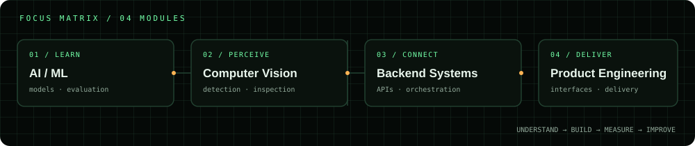
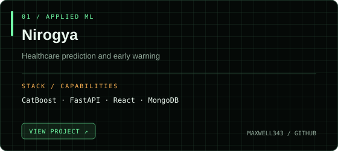
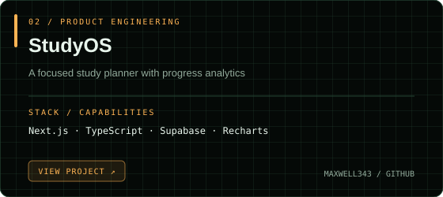
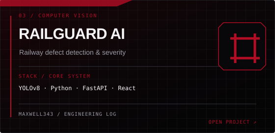
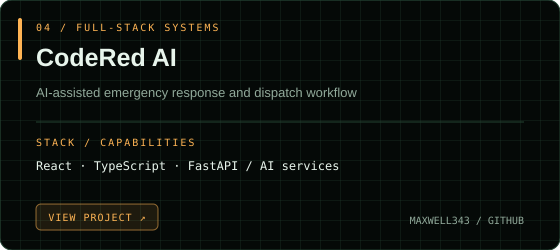
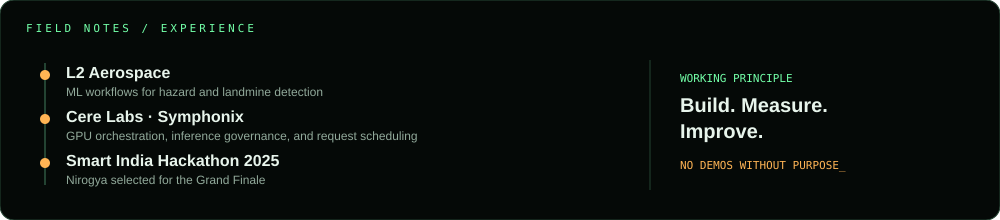
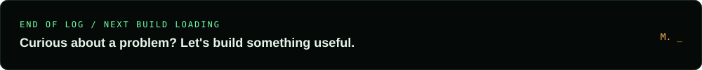

<a href="https://github.com/Maxwell343">GITHUB</a> &nbsp; / &nbsp; <a href="https://www.linkedin.com/in/maxwell-mathew-97961b2b7">LINKEDIN</a> &nbsp; / &nbsp; <a href="https://ptfl-1-three.vercel.app/">PORTFOLIO</a>

**AI ENGINEERING / APPLIED ML / BACKEND SYSTEMS / FULLSTACK ENGINEERING**

*Less wondering, more prototyping. Building what I wish existed.*

---

## `01 / FIELD NOTES`

I'm an Final Year Information Technology student focused on the full lifecycle of technical projects—not just training a model, but building the data pipelines, backend services, and interfaces needed to make it genuinely useful.

My loop is simple: **understand → build → measure → improve.** I value systems that are testable, understandable, and useful.

## `02 / SELECTED BUILDS`

### `03 / OTHER BUILDS`

- [Annam — Food Rescue Platform](https://github.com/Maxwell343/Annam-foodcrops_rescue_platform)
- [TransitOps — Logistics & Fleet Command Surface](https://github.com/Maxwell343/TransitOps-Logistics_and_Fleet_Command_Surface)
- [Soundwave — Musical Instruments Platform](https://github.com/Maxwell343/Soundwave_Musical_Instruments_Platform)
- [Livify — Home Rental Platform](https://github.com/Maxwell343/Livify--Home_Rental_Platform)

## `04 / EXPERIENCE & MILESTONES`

- **L2 Aerospace — Machine Learning Engineering Intern:** ML workflows for hazard and landmine detection, including dataset preparation, model experimentation, and evaluation.
- **Cere Labs — Symphonix industry project:** GPU orchestration, inference governance, resource management, and request scheduling.
- **Smart India Hackathon 2025:** Nirogya selected for the Grand Finale.
- **Google Developers Group Hackathon:** team placed among the top 12.

## `05 / TOOLCHAIN`

**Languages**  

**Machine Learning & Computer Vision**  

**Web, Backends & Databases**  

## `06 / CONTACT`

Portfolio: [ptfl-1-three.vercel.app](https://ptfl-1-three.vercel.app/)  
LinkedIn: [Maxwell Mathew](https://www.linkedin.com/in/maxwell-mathew-97961b2b7)  
GitHub: [@Maxwell343](https://github.com/Maxwell343)

